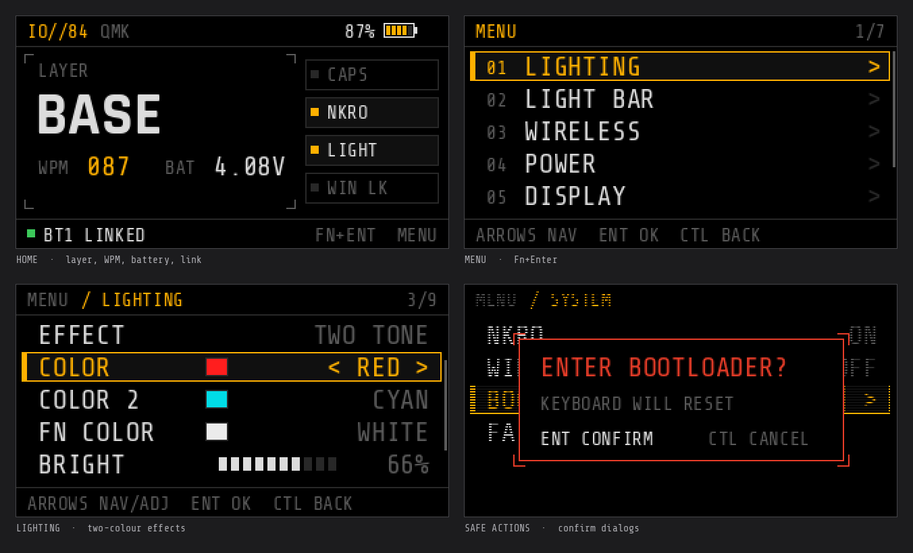

# IO Type 84 Pro Wireless — QMK firmware

Open-source [QMK](https://qmk.fm) firmware for the **IO by Red Square Type 84 Pro Wireless**
(USB `0c45:8009`, Sonix **SN32F290** MCU), built on the [SonixQMK](https://github.com/SonixQMK/qmk_firmware) fork.

Everything the stock firmware does — and a bit more: the LCD becomes a real
HUD with an on-device settings menu, the light bar under the screen gets its own modes,
and Bluetooth / 2.4 GHz, battery reporting and auto-sleep all keep working.



> [!WARNING]
> This is an unofficial, reverse-engineered firmware. Flashing is reversible (see
> [Going back to stock](docs/flashing.md#going-back-to-stock)), but you do it at your own risk.

## Features

| | |
|---|---|
| ⌨️ **Keys** | Full 84-key layout, NKRO over USB **and** Bluetooth / 2.4 GHz (on by default), QMK keymaps |
| 🎛️ **Knob** | The removable knob works in both spots (Esc or PrtSc): volume, mute, next/prev track on Fn |
| 🖥️ **Display** | 320×172 HUD: layer, WPM, battery, link status, lock indicators — plus a full settings menu |
| 🌈 **RGB** | Per-key RGB with 30+ effects, including 7 custom **two-colour** effects; black is a colour too |
| 🔦 **Fn overlay** | Hold Fn and only the keys bound on the Fn layer light up, in a colour of your choice |
| 📏 **Light bar** | The 9-LED strip under the screen: WPM meter, battery gauge, link status, scanner, Caps alert |
| 📡 **Wireless** | Bluetooth (5 host slots) and 2.4 GHz dongle via the built-in radio module, pairing from the keyboard |
| 🔋 **Battery** | Charge level on screen and in the OS — over Bluetooth, the 2.4 GHz dongle **and** USB (Linux) |
| 💤 **Power** | Configurable auto-sleep in wireless modes (deep sleep, any key/knob/switch wakes it) |
| 🛟 **Safety nets** | Hold Esc while plugging in → bootloader; a watchdog drops a hung firmware into the bootloader |

## Quick start

You need: Linux (macOS should work too), `git`, `make`, Python 3 with [`qmk`](https://pypi.org/project/qmk/)
(`pip install qmk`), an `arm-none-eabi-gcc` toolchain, and
[SonixFlasherC](https://github.com/SonixQMK/SonixFlasherC) (`sonixflasher`).

```sh
# 1. get the sources and a patched SonixQMK tree
git clone https://github.com/<you>/io-type84-pro-qmk.git
cd io-type84-pro-qmk
./setup.sh

# 2. build
make -C qmk_firmware io/type84_pro:default

# 3. allow flashing without sudo (once)
sudo cp udev/70-io-type84-pro.rules /etc/udev/rules.d/ && sudo udevadm control --reload

# 4. flash — set the mode switch to USB first
./flash.sh
```

`flash.sh` puts a **stock** keyboard into its bootloader by itself. On QMK, enter the
bootloader from the menu (**Fn+Enter → SYSTEM → BOOTLOADER**) or **hold Esc while plugging
the cable in**. Details, recovery and going back to stock: [docs/flashing.md](docs/flashing.md).

## Using it

### Fn layer

| Keys | Action |
|---|---|
| **Fn+Enter** | Open the menu / select / confirm |
| **Fn+Ctrl** (either) | Back / cancel |
| **Fn+arrows** | Navigate the menu and change values. Outside the menu: **↑↓** brightness, **←→** lighting effect |
| **Fn+Space** | Lighting on / off |
| **Fn+H / J**, **Fn+K / L** | Hue − / +, effect speed − / + |
| **Fn+1 … 5** | Bluetooth slot 1–5 — **hold 3 s to pair** |
| **Fn+6** | In 2.4 GHz mode: **hold 3 s** to pair with the dongle |
| **Fn+S** | Auto-sleep timer: 5 → 10 → 30 min → off → 1 min |
| **Fn+N**, **Fn+Win** | NKRO on/off, Win key lock |
| **Fn+PgUp / PgDn** | Home / End |
| **Fn+F1 / F2**, **F5–F7**, **F9–F11** | Screen brightness, media prev/play/next, mute / volume |
| Knob | Volume (Fn: previous / next track); press = mute. In the menu: scroll and select |

The **mode switch** on the back selects USB / Bluetooth / 2.4 GHz. In wireless modes the
keyboard disconnects from USB, just like the stock firmware (the cable only charges).

### On-screen menu

| Page | Settings |
|---|---|
| **LIGHTING** | on/off, effect, colour, colour 2 (two-colour effects), Fn overlay colour, brightness, hue, saturation, speed |
| **LIGHT BAR** | mode (WPM, WPM bar, battery, link, scanner, off), colour, Caps Lock alert |
| **WIRELESS** | current mode, Bluetooth slot, pair now |
| **POWER** | auto-sleep timer, battery %, voltage, charging status |
| **DISPLAY** | UI accent colour (amber, green, cyan, red, white), screen-off timeout |
| **SYSTEM** | NKRO, Win lock, bootloader, factory reset (both with a confirmation) |
| **ABOUT** | firmware, build date, MCU, uptime |

The menu closes by itself after 30 s. Settings are stored in the keyboard.

### Lighting

Besides the stock QMK effects there are custom two-colour effects that use **COLOR** and
**COLOR 2** from the menu: **TWO TONE** (letters / modifiers), **GRADIENT 2**, **CROSSFADE 2**,
**SCANNER 2**, **STARLIGHT 2**, **REACTIVE 2** and **RIPPLE 2** (both react to key presses).
Rows that the current effect doesn't use are dimmed in the menu.

### Battery in your OS

- **Bluetooth / 2.4 GHz:** shown by the OS like any wireless keyboard.
- **USB (Linux):** the firmware exposes a standard HID battery, so `upower` and desktop
  battery widgets list the keyboard with its charge and charging state.

## Documentation

| | |
|---|---|
| [docs/flashing.md](docs/flashing.md) | Flashing, recovery, going back to stock |
| [docs/hardware.md](docs/hardware.md) | Reverse-engineered hardware map: pins, matrix, LEDs, display, radio, battery |
| [docs/radio-protocol.md](docs/radio-protocol.md) | UART protocol between the MCU and the BT / 2.4 GHz module |
| [docs/development.md](docs/development.md) | How the port is built, gotchas, customising, debugging |

## Status and limitations

- Tested on one keyboard (stock firmware v1.32), on Linux.
- Raw HID / host data on the screen (clock, CPU load, …) is not implemented yet.
- The SPI flash with the stock screen animations is not used.
- System power keys and mouse keys are not sent over the air (format unverified).
- The core patch narrows QMK's *System Control* report to power / sleep / wake, so
  `KC_SYSTEM_RESTART` and similar rarely used keys do nothing.

## Credits

- [QMK](https://github.com/qmk/qmk_firmware) and [SonixQMK](https://github.com/SonixQMK/qmk_firmware) — the firmware and the SN32 port
- [SonixFlasherC](https://github.com/SonixQMK/SonixFlasherC) — the flasher
- [ChibiOS](https://www.chibios.org) / ChibiOS-Contrib — the RTOS and HAL
- Fonts: [Share Tech Mono](https://fonts.google.com/specimen/Share+Tech+Mono) and
  [Rajdhani](https://fonts.google.com/specimen/Rajdhani) (SIL Open Font License, see `fonts/`)

Not affiliated with IO by Red Square.

## License

GPL-2.0-or-later, like QMK — see [LICENSE](LICENSE). The bundled fonts are under the
SIL Open Font License 1.1.
